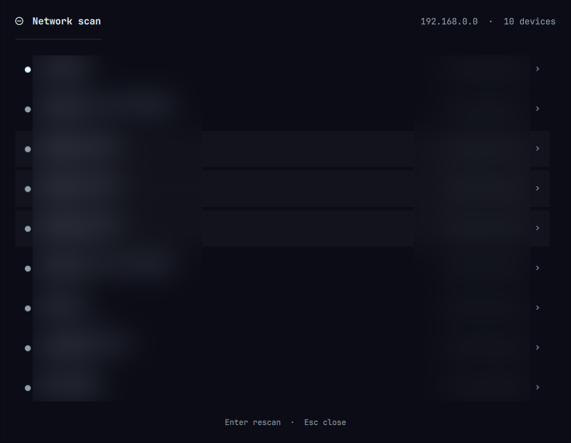
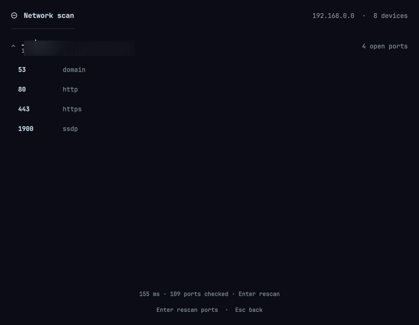

# Network Scan for Omarchy

Fing-style LAN discovery in the bar. The widget shows how many devices are on
your network, lists them by name, and scans the open ports of any device you
pick.



Everything runs as your normal user: the sweep needs only the setuid bit on
`ping`, and the neighbour table is world-readable. No root, no `CAP_NET_RAW`.

## Install

```sh
omarchy plugin add https://github.com/stylder/omarchy-netscan
```

Then place the widget in your bar:

```sh
omarchy plugin enable stylder.netscan
```

The plugin asks which bar section to use; `right` is the default. To change it
later, edit the `bar.layout` entry in `~/.config/omarchy/shell.json`.

### Optional: menu entries

The widget is the main interface. These entries in
`~/.config/omarchy/extensions/omarchy-menu.jsonc` add the same scan to the
Super menu, plus a terminal version of it:

```jsonc
"system.network-scan": { "icon": "󰍷", "label": "Network scan" },
"system.network-scan.panel": { "icon": "󰍷", "label": "Show devices", "action": "omarchy-shell stylder.netscan toggle", "description": "Device list in the bar" },
"system.network-scan.terminal": { "icon": "", "label": "Scan in terminal", "action": "omarchy-launch-tui \"zsh -c 'netscan; read -k 1?Press any key to close'\"", "description": "Full table with MAC and vendor" },
"system.network-scan.json": { "icon": "󰅌", "label": "Scan as JSON", "action": "omarchy-launch-tui \"zsh -c 'netscan --json | jq .; read -k 1?Press any key to close'\"", "description": "Machine-readable output" }
```

The terminal entries call `netscan` from your `PATH`. Put the script there
with:

```sh
ln -s ~/.config/omarchy/plugins/stylder.netscan/bin/netscan ~/.local/bin/netscan
```

## Requirements

Everything the plugin needs is already on a normal Omarchy install:

| Tool | Used for | Without it |
|---|---|---|
| `ping` (iputils) | the sweep | the plugin cannot scan |
| `ip` (iproute2) | the interface and the neighbour table | the plugin cannot scan |
| `nc` (netcat) | the port scan | no open ports are listed |
| `getent` (glibc) | service names for the ports | ports are listed by number only |
| `avahi-resolve-address` | mDNS names | names fall back to reverse DNS |
| `nmap` | the vendor column | the column is left out |

On Arch, the only one usually worth installing is netcat:

```sh
sudo pacman -S netcat-openbsd
```

## Using it

- **Left-click** the bar icon to open the device list.
- **Middle-click** to rescan without opening the panel.
- **Click a device** to scan its open ports.
- **Enter** rescans (ports, when a device is selected).
- **Esc** steps back out to the device list, and closes the panel.

### Open ports



Selecting a device scans its TCP ports and lists them with the service each
one answers with. The scan is a plain connect scan, so it needs no root
either. A few well-known ports are turned into a hint about what the device
is (Plex, a printer, an RDP host) — it is a guess, not a verdict.

The same scan is available from the command line:

```sh
netscan --ports 192.168.0.1        # the common port set, about a second
netscan --ports 192.168.0.1 --full # all 65535 ports, about a minute
```

### Copying

Every row carries a copy button:

- in the device list it copies the address on its own (`192.168.0.1`)
- in the port list it copies the address with the port (`192.168.0.1:443`)

The text goes to the clipboard with `wl-copy`, so the clipboard history picks
it up as well, and the button shows a tick for a moment to say that it
worked.

### The cache

The last scan is written to `~/.local/state/omarchy/netscan.json`, together
with the last port result of every host that has been opened. The panel reads
it on startup, so it opens with the previous list already in place instead of
an empty one — the sweep takes a second or two, and a device that was there a
minute ago is more useful than nothing.

The live scan replaces the cached list when it lands. A scan that finds
nothing does not erase what is already known: a device that is asleep is
still a device on the network.

## The command line

The scanner is a standalone script and works on its own:

```sh
netscan              # table: IP, MAC, name, vendor
netscan --json       # machine-readable, used by the bar widget
netscan --iface wlp0s20f3
```

## How it works

Discovery is a parallel ICMP sweep over the interface's subnet. The sweep
populates the kernel neighbour table, and MAC addresses are read from there.
Names come from mDNS via `avahi-resolve-address`, falling back to reverse
DNS — that is what turns `192.168.0.131` into `LGwebOSTV-FsPj-1`.

Two details worth knowing:

- **Results are merged across runs.** The neighbour table before the sweep is
  kept and merged with the result afterwards. Devices that ignore ICMP never
  create a fresh entry, so without this the list would shrink between runs
  just because a phone was asleep.
- **`DELAY` and `PROBE` are healthy states.** The kernel marks freshly
  resolved entries with them while planning to revalidate; they are not
  failures.

## The vendor column

The vendor column needs an OUI database. `netscan` uses
`/usr/share/nmap/nmap-mac-prefixes` when present and simply omits the column
otherwise — it never guesses from the locally-administered bit, since that
would mislabel randomised MACs as real hardware.

To enable it:

```sh
omarchy pkg add nmap
```

## Settings

Per-widget overrides go in the widget's `shell.json` layout entry:

```json
{ "id": "stylder.netscan", "refreshSeconds": 300 }
```

The panel rescans when it opens and every `refreshSeconds` while it stays
open (default 120, minimum 30). No scan happens on the bar's startup path.

## Troubleshooting

**"netscan could not be run"** — the plugin folder is missing its `bin/`
directory. Reinstall the plugin, or put `netscan` on your `PATH`.

**A device is missing** — it may be blocking ICMP. Give it a moment and
rescan; the merge keeps previously-seen devices visible.

**Fewer devices than Fing shows** — expected without root. Fing scans at the
ARP layer, so it sees devices that drop ICMP and that this unprivileged sweep
cannot. Installing `nmap` and scanning with `sudo nmap -sn` covers the rest.

**The panel shows the old devices** — that is the cache. It is replaced when
the live scan lands; a scan that finds nothing leaves it alone on purpose.

## Development

```sh
git clone https://github.com/stylder/omarchy-netscan
cd omarchy-netscan
./scripts/validate-manifest.sh .
```

`scripts/validate-manifest.sh` mirrors the checks the shell runs when it
loads a plugin, so the folder can be validated without installing Omarchy.
With Omarchy installed, `omarchy plugin validate .` is the authoritative
check.

The widget is `Panel.qml` (the panel) plus `Model.js` (parsing and
formatting, kept out of the QML so it can be exercised on its own). The
scanner is `bin/netscan`.

Note that the Omarchy shell does not reload plugin QML when it changes:
`QS_DISABLE_FILE_WATCHER=1` is set on purpose, so run `omarchy-restart-shell`
after editing a plugin.

## License

MIT — see [LICENSE](LICENSE).
